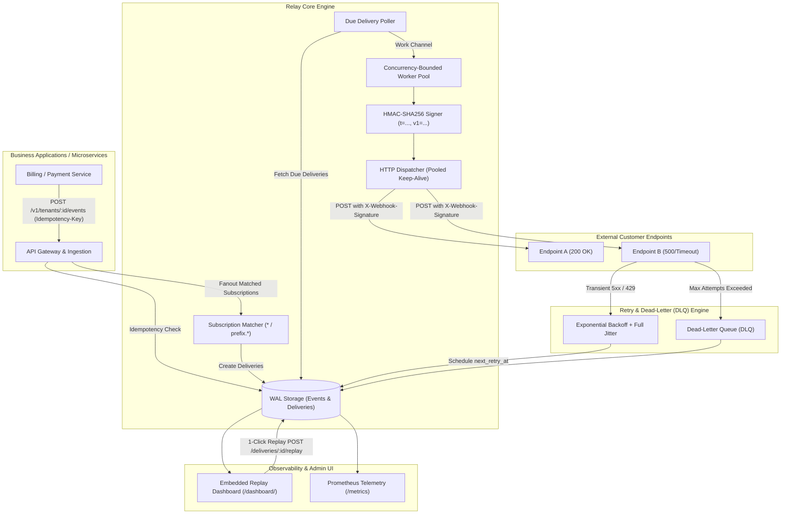

# ⚡ Relay: Multi-Tenant Webhook & Event Delivery Engine

[](https://golang.org)
[](LICENSE)
[](https://github.com/Chiru9030/multi-tenant-webhook-service)
[](https://golang.org)

**Relay** is a high-throughput, multi-tenant webhook and event delivery engine inspired by **Stripe Webhooks** and **Svix**. Built from scratch in Go, Relay allows multi-tenant platforms to register webhook destinations, ingest asynchronous business events with strict idempotency, sign outbound payloads with HMAC-SHA256, and dispatch millions of webhooks with bounded concurrency, exponential backoff, and dead-letter queue (DLQ) recovery.

Includes an **embedded real-time delivery dashboard & 1-click replay UI** compiled directly into the binary via `embed.FS`.

---

## 🏗️ Architecture Overview



---

## 🔑 Key Engineering Highlights

### 1. Cryptographic HMAC-SHA256 Signature Header
Each delivery includes security headers matching the standard pioneered by Stripe and GitHub:
- `X-Webhook-Signature: t=1700000000,v1=9b3c4...`
- Payload signing canonical format: `"{timestamp}.{raw_payload}"`
- **Replay Attack Defense:** Tolerance window check ensures requests older than 5 minutes are discarded by receivers.
- **Timing Attack Mitigation:** Constant-time equality checks using `crypto/subtle` / `hmac.Equal`.

### 2. Full Jitter Exponential Backoff
To avoid **thundering herd** problems against degraded customer endpoints, backoff sleep uses the AWS Full Jitter algorithm:
$$\text{Sleep} = \text{UniformRandom}(0, \min(T_{\max}, T_{\text{base}} \times M^{\text{attempt}-1}))$$
- $T_{\text{base}} = 3\text{s}$
- Multiplier $M = 2.5$
- Default Maximum Attempts: 5

### 3. Strict Idempotency & Wildcard Routing
- Ingestion supports `Idempotency-Key` headers. Re-submitting the exact same event returns the existing event without re-queueing duplicate webhooks.
- Subscriptions support hierarchical wildcards: `payment.*`, `invoice.paid`, or `*` for catch-all delivery.

### 4. Zero-Dependency Pure-Go Storage with WAL
Backed by pure-Go SQLite with Write-Ahead Logging (`PRAGMA journal_mode=WAL; PRAGMA synchronous=NORMAL;`) enabling simultaneous readers and writers with zero CGO compilation flags.

---

## 📊 Live Embedded Delivery Dashboard & Replay UI

Relay compiles a modern dark-mode monitoring dashboard directly into the binary:
- **Real-Time Delivery Audits:** Live trace table with latency, HTTP response codes, and error messages.
- **Event Inspector:** Inspect raw payload JSON, signed headers, and attempt history.
- **1-Click Replay:** Instantly reschedule any failed delivery or DLQ record with zero downtime.
- **Bulk Endpoint DLQ Replay:** `POST /v1/endpoints/:id/replay-all`

---

## 🚀 Quick Start

### Option A: Run Locally with Go

```bash
git clone https://github.com/Chiru9030/multi-tenant-webhook-service.git
cd multi-tenant-webhook-service
cp .env.example .env
set -a && source .env && set +a

# Run all unit, integration & concurrency race tests
go vet ./...
go test -v -race -count=1 ./...

# Start server (WEBHOOK_ADMIN_API_KEY protects /v1/* routes)
go run ./cmd/server -port=8080 -workers=15
```

Open your browser at **[http://localhost:8080/dashboard/](http://localhost:8080/dashboard/)**.

### Option B: Run with Docker Compose

```bash
docker compose up --build -d
```

Verify liveness and SQLite readiness:
```bash
curl http://localhost:8080/healthz
# {"service":"relay-webhook-service","status":"healthy"}

curl http://localhost:8080/readyz
# {"database":"sqlite_wal_ok","status":"ready"}
```

### Option C: Production Deployments (Kubernetes, Render, Linux VM)
- **Kubernetes (`k8s/`):** Deploys a single-replica `StatefulSet` backed by a `5Gi` `ReadWriteOnce` PVC (`k8s/statefulset.yaml`), `ConfigMap` (`k8s/configmap.yaml`), `ClusterIP` `Service` (`k8s/service.yaml`), non-root container (`UID 10001`), `/healthz` liveness probe, and `/readyz` readiness probe (avoiding SQLite WAL split-brain).
- **Cloud (`render.yaml`):** Render Docker Blueprint with `/healthz` checks and auto-generated `WEBHOOK_ADMIN_API_KEY` & `DEMO_WEBHOOK_SECRET` (uses ephemeral SQLite on the free plan; attach a persistent disk on paid plans for durable storage across deploys).
- **Linux VM (`deploy/vm/provision.sh`):** Builds a stripped static binary (`CGO_ENABLED=0`), provisions a locked `webhooksvc` service user, and installs a hardened `systemd` unit (`NoNewPrivileges=true`, `ProtectSystem=strict`).
- **CI/CD (`.github/workflows/ci.yml`):** Automated `go vet`, `go build`, `go test -v -race -count=1 ./...`, and Docker image build verification on push/PR.

---

## ⚙️ Configuration & Security

| Variable | Default | Description |
| :--- | :--- | :--- |
| `PORT` | `8080` | HTTP server listen port (used when `-port` stays default) |
| `DB_PATH` | `webhooks.db` | SQLite WAL database path |
| `WEBHOOK_ADMIN_API_KEY` | *(unset)* | Optional bearer / `X-API-Key` secret protecting `/v1/*` APIs via SHA-256 constant-time comparison (`/healthz`, `/readyz`, `/metrics`, and `/dashboard/` remain accessible) |
| `ALLOWED_ORIGINS` | `*` | Single origin or comma-separated CORS allowlist emitting `Vary: Origin` |
| `DEMO_WEBHOOK_SECRET` | *(random generated)* | Optional deterministic HMAC secret for seeded demo endpoint |

Security hardening in `v1.0.0`:
- Atomic transactional SQLite delivery claims (`status = 'sending'`) bounded by worker queue headroom + `120s` stale-claim recovery prevent duplicate webhook dispatches under concurrent pollers.
- Full SSRF protection blocks loopback (`127.0.0.0/8`, `::1`, `localhost`), RFC1918/ULA private ranges, link-local cloud metadata (`169.254.169.254`), DNS-rebinding at dial time (`net.Dialer.Control`), and unsafe HTTP redirects on outbound webhooks.
- Single-writer SQLite connection pool (`SetMaxOpenConns(1)`) prevents `SQLITE_BUSY` errors and eliminates TOCTOU races in idempotent event creation.
- Per-request timeouts honoring `endpoint.TimeoutSeconds` (`1–60s`), `1 MiB` request body cap (`413` on overflow) across tenant/endpoint/event ingestion, tenant-isolated stats aggregation, XSS-safe DOM rendering (`textContent`), and `X-Content-Type-Options`/`X-Frame-Options`/`Referrer-Policy` headers.

---

## 📡 API Reference

*(Pass `Authorization: Bearer <WEBHOOK_ADMIN_API_KEY>` or `X-API-Key: <WEBHOOK_ADMIN_API_KEY>` when `WEBHOOK_ADMIN_API_KEY` is configured.)*

### 1. Register a Tenant
```bash
POST /v1/tenants
Content-Type: application/json

{ "name": "Acme Corp" }
```

### 2. Register a Destination Endpoint
```bash
POST /v1/tenants/:tenant_id/endpoints
Content-Type: application/json

{
  "url": "https://api.acme.com/webhooks",
  "description": "Production Payment Receiver",
  "event_types": ["payment.*", "customer.subscription.*"],
  "max_retries": 5,
  "timeout_seconds": 10
}
```
*Response contains auto-generated HMAC secret key (`whsec_...`).*

### 3. Ingest Business Event
```bash
POST /v1/tenants/:tenant_id/events
Content-Type: application/json
Idempotency-Key: evt_ord_102948290

{
  "event_type": "payment.succeeded",
  "payload": {
    "order_id": "ord_102948",
    "amount": 4900,
    "currency": "usd",
    "customer": "cus_9941"
  }
}
```

### 4. Manual & Bulk Delivery Replay
```bash
POST /v1/deliveries/:delivery_id/replay
POST /v1/endpoints/:endpoint_id/replay-all
```

### 5. Health, Readiness & Prometheus Telemetry
```bash
GET /healthz
GET /readyz
GET /metrics
```
Metrics exported:
- `webhook_service_events_ingested_total`
- `webhook_service_delivery_attempts_total`
- `webhook_service_delivery_latency_seconds_bucket`
- `webhook_service_dead_letter_total`
- `webhook_service_active_workers`
- `webhook_service_queue_depth`

---

## 🧪 Testing & Verification

The test suite verifies backoff math, HMAC signature/replay checks, SQLite WAL storage CRUD, idempotent event ingestion, single-delivery transactional locking under concurrency, DLQ escalation, replay APIs, `/readyz`, admin API-key enforcement, security headers, and destination URL validation:

```bash
go test -v -race -count=1 ./...
```

Covered tests across `internal/backoff`, `internal/crypto`, `internal/storage`, and `tests`:
- `TestCalculateNextRetry`
- `TestSignAndVerifySignature`
- `TestTenantAndEndpointCRUD`
- `TestEventIdempotency`
- `TestDeliveryLifecycleAndDLQReplay`
- `TestEndToEndSuccessfulDelivery`
- `TestRetryAndDLQEscalation`
- `TestManualReplayAPI`
- `TestAdminAuthReadyzSecurityHeadersAndURLValidation`
- `TestWebhookAuditRegressions` (covers idempotent `Dispatcher.Stop()`, SSRF blocking, `1 MiB` `413` body limits, JSON `null`/`404` checks, concurrent `Idempotency-Key` race hydration, exclusive concurrent `FetchDueDeliveries` locking, `replay-all`, comma CORS + `Vary: Origin`, and tenant-isolated latency stats)

---

## 📜 License
MIT License. Built by [Chiru9030](https://github.com/Chiru9030).
