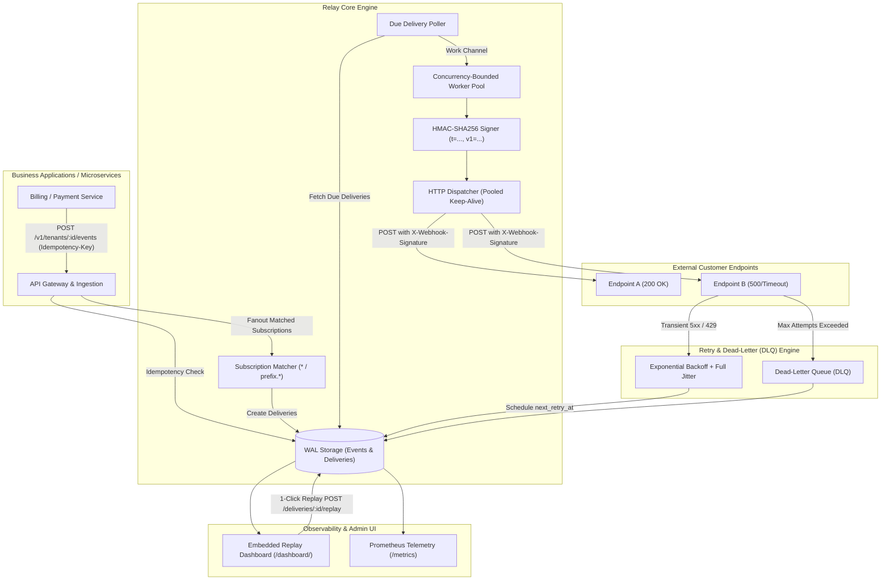

# ⚡ Relay: Multi-Tenant Webhook & Event Delivery Engine

[](https://golang.org)
[](LICENSE)
[](https://github.com/Chiru9030/multi-tenant-webhook-service)
[](https://golang.org)

**Relay** is a high-throughput, multi-tenant webhook and event delivery engine inspired by **Stripe Webhooks** and **Svix**. Built from scratch in Go, Relay allows multi-tenant platforms to register webhook destinations, ingest asynchronous business events with strict idempotency, sign outbound payloads with HMAC-SHA256, and dispatch millions of webhooks with bounded concurrency, exponential backoff, and dead-letter queue (DLQ) recovery.

Includes an **embedded real-time delivery dashboard & 1-click replay UI** compiled directly into the binary via `embed.FS`.

---

## 🏗️ Architecture Overview



---

## 🔑 Key Engineering Highlights

### 1. Cryptographic HMAC-SHA256 Signature Header
Each delivery includes security headers matching the standard pioneered by Stripe and GitHub:
- `X-Webhook-Signature: t=1700000000,v1=9b3c4...`
- Payload signing canonical format: `"{timestamp}.{raw_payload}"`
- **Replay Attack Defense:** Tolerance window check ensures requests older than 5 minutes are discarded by receivers.
- **Timing Attack Mitigation:** Constant-time equality checks using `crypto/subtle` / `hmac.Equal`.

### 2. Full Jitter Exponential Backoff
To avoid **thundering herd** problems against degraded customer endpoints, backoff sleep uses the AWS Full Jitter algorithm:
$$\text{Sleep} = \text{UniformRandom}(0, \min(T_{\max}, T_{\text{base}} \times M^{\text{attempt}-1}))$$
- $T_{\text{base}} = 3\text{s}$
- Multiplier $M = 2.5$
- Default Maximum Attempts: 5

### 3. Strict Idempotency & Wildcard Routing
- Ingestion supports `Idempotency-Key` headers. Re-submitting the exact same event returns the existing event without re-queueing duplicate webhooks.
- Subscriptions support hierarchical wildcards: `payment.*`, `invoice.paid`, or `*` for catch-all delivery.

### 4. Zero-Dependency Pure-Go Storage with WAL
Backed by pure-Go SQLite with Write-Ahead Logging (`PRAGMA journal_mode=WAL; PRAGMA synchronous=NORMAL;`) enabling simultaneous readers and writers with zero CGO compilation flags.

---

## 📊 Live Embedded Delivery Dashboard & Replay UI

Relay compiles a modern dark-mode monitoring dashboard directly into the binary:
- **Real-Time Delivery Audits:** Live trace table with latency, HTTP response codes, and error messages.
- **Event Inspector:** Inspect raw payload JSON, signed headers, and attempt history.
- **1-Click Replay:** Instantly reschedule any failed delivery or DLQ record with zero downtime.
- **Bulk Endpoint DLQ Replay:** `POST /v1/endpoints/:id/replay-all`

---

## 🚀 Quick Start

### Option A: Run Locally with Go

```bash
git clone https://github.com/Chiru9030/multi-tenant-webhook-service.git
cd multi-tenant-webhook-service

# Run all unit, integration & race tests
go test -v -race ./...

# Start server
go run cmd/server/main.go --port=8080 --workers=15
```

Open your browser at **[http://localhost:8080/dashboard/](http://localhost:8080/dashboard/)**.

### Option B: Run with Docker Compose

```bash
docker compose up --build -d
```

Verify service health:
```bash
curl http://localhost:8080/healthz
# {"service":"relay-webhook-service","status":"healthy"}
```

---

## 📡 API Reference

### 1. Register a Tenant
```bash
POST /v1/tenants
Content-Type: application/json

{ "name": "Acme Corp" }
```

### 2. Register a Destination Endpoint
```bash
POST /v1/tenants/:tenant_id/endpoints
Content-Type: application/json

{
  "url": "https://api.acme.com/webhooks",
  "description": "Production Payment Receiver",
  "event_types": ["payment.*", "customer.subscription.*"],
  "max_retries": 5,
  "timeout_seconds": 10
}
```
*Response contains auto-generated HMAC secret key (`whsec_...`).*

### 3. Ingest Business Event
```bash
POST /v1/tenants/:tenant_id/events
Content-Type: application/json
Idempotency-Key: evt_ord_102948290

{
  "event_type": "payment.succeeded",
  "payload": {
    "order_id": "ord_102948",
    "amount": 4900,
    "currency": "usd",
    "customer": "cus_9941"
  }
}
```

### 4. Manual Delivery Replay
```bash
POST /v1/deliveries/:delivery_id/replay
```

### 5. Prometheus Telemetry
```bash
GET /metrics
```
Metrics exported:
- `webhook_service_events_ingested_total`
- `webhook_service_delivery_attempts_total`
- `webhook_service_delivery_latency_seconds_bucket`
- `webhook_service_dead_letter_total`
- `webhook_service_active_workers`
- `webhook_service_queue_depth`

---

## 🧪 Testing & Verification

The test suite covers full lifecycle end-to-end execution, wildcard subscription matching, idempotent ingestion, retry scheduling, and race conditions:

```bash
go test -v -race ./...
```

Output:
```
=== RUN   TestSignAndVerifySignature
--- PASS: TestSignAndVerifySignature (0.00s)
=== RUN   TestCalculateNextRetry
--- PASS: TestCalculateNextRetry (0.00s)
=== RUN   TestTenantAndEndpointCRUD
--- PASS: TestTenantAndEndpointCRUD (0.03s)
=== RUN   TestEventIdempotency
--- PASS: TestEventIdempotency (0.02s)
=== RUN   TestDeliveryLifecycleAndDLQReplay
--- PASS: TestDeliveryLifecycleAndDLQReplay (0.03s)
=== RUN   TestEndToEndSuccessfulDelivery
--- PASS: TestEndToEndSuccessfulDelivery (0.12s)
=== RUN   TestRetryAndDLQEscalation
--- PASS: TestRetryAndDLQEscalation (1.19s)
=== RUN   TestManualReplayAPI
--- PASS: TestManualReplayAPI (0.20s)
PASS ok  github.com/Chiru9030/multi-tenant-webhook-service
```

---

## 📜 License
MIT License. Built by [Chiru9030](https://github.com/Chiru9030).
